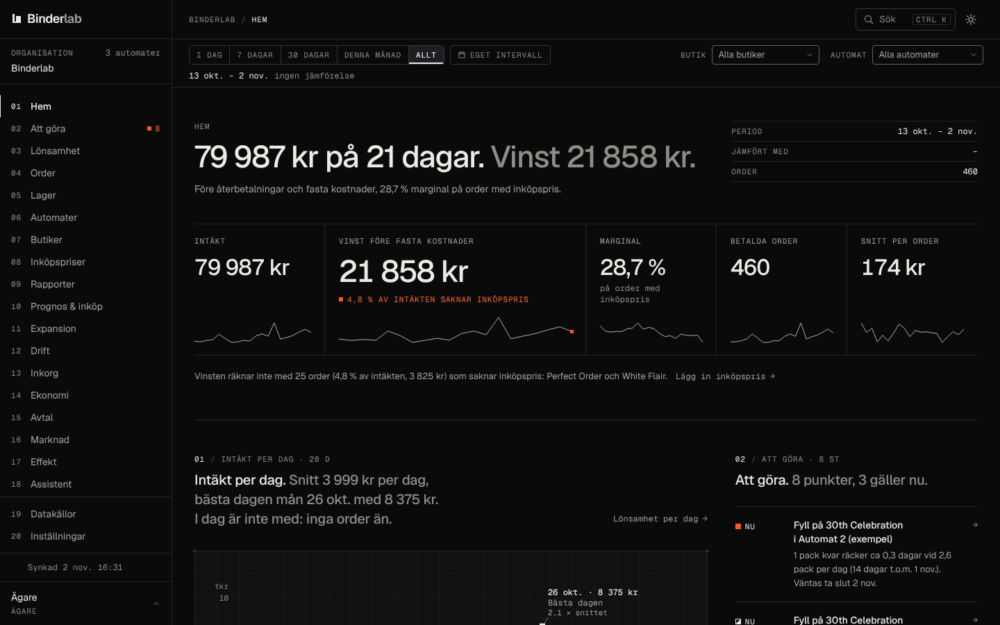
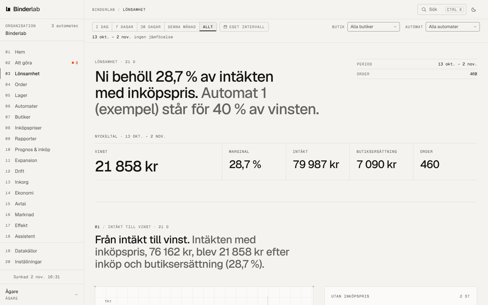
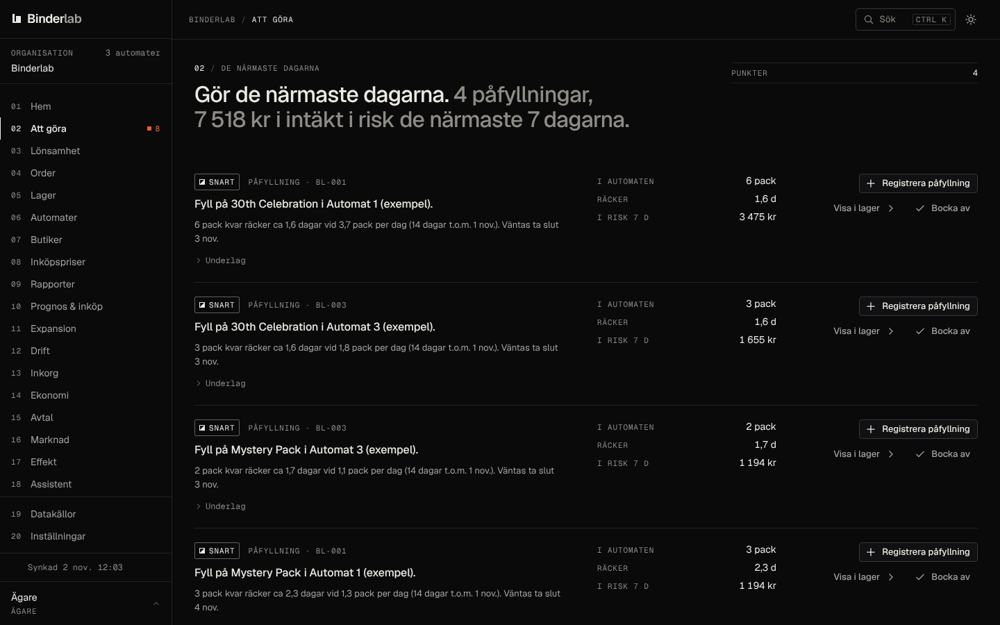
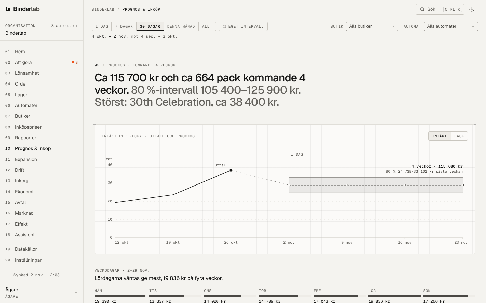
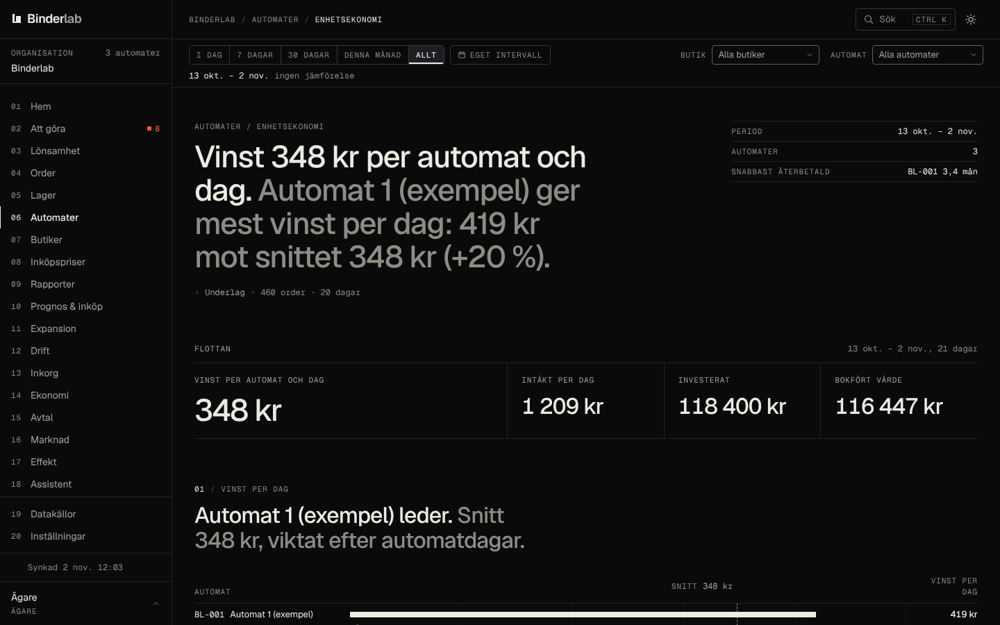
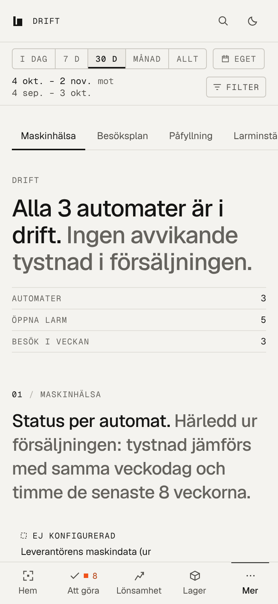

# Binderlab

Kontrollpanel för operatörer av varuautomater med samlarkortspack. Binderlab läser in försäljningen från
automatleverantören (Awish), räknar vinsten per titel, automat och butik efter inköp och butiksersättning, säger vad
som ska fyllas på innan det tar slut, larmar när en automat slutar sälja och skapar månadsrapporterna till butiker,
bokhållare och delägare.

**För vem:** ägaren och delägarna i ett bolag som har automater utställda i butiker, påfyllaren i fält (mobilen,
fungerar utan nät), butikerna (egen portal) och bokhållaren (SIE 4 och Excel). Vad panelen löser och vilka siffror den
visar står i [docs/product.md](docs/product.md).

## Skärmbilder

Utvecklingsdatabasen efter `npm run db:seed` (verksamhetens riktiga försäljning 13 okt.–1 nov. 2026 med
exempelbutiker), inloggad som ägare.

|                                                                                              |                                                                                                     |
| -------------------------------------------------------------------------------------------- | --------------------------------------------------------------------------------------------------- |
|  |            |
| **Hem:** intäkt, vinst, marginal, Att göra och mest sålda titlar                             | **Lönsamhet:** från intäkt till vinst, order utan inköpspris och butiksersättning                   |
|     |  |
| **Att göra:** påfyllningar med lager, räckvidd och intäkt i risk                             | **Prognos & inköp:** utfall och prognos per vecka med 80 %-intervall                                |
|     |                                     |
| **Enhetsekonomi:** vinst per automat och dag, investering och återbetalning                  | **Drift på mobilen (375 px):** maskinhälsa, besöksplan och påfyllning                               |

## Snabbstart lokalt

Krav: Node 22, Postgres 16 och (för PDF) en Chromium som puppeteer-core hittar. Kör inte mot en databas som inte är
lokal: `db:reset` och dev-inloggningen vägrar allt annat än `127.0.0.1`/`localhost`.

```sh
# 1. Postgres 16 på port 54322, till exempel i Docker:
docker run -d --name binderlab-pg -p 54322:5432 -e POSTGRES_HOST_AUTH_METHOD=trust postgres:16

# 2. Beroenden och miljö
npm ci
cp .env.example .env.local
#    Sätt DEV_AUTH_SECRET i .env.local:  openssl rand -base64 48
#    DATABASE_URL och DATABASE_URL_TEST pekar redan på 127.0.0.1:54322.

# 3. Databasen: skapa om (auth-shim + alla migreringar), seeda och lägg in demon
npm run db:reset -- dev
npm run db:seed        # 460 riktiga order 13 okt.–1 nov. 2026, tre exempelbutiker och automater
npm run db:seed-demo   # valfritt: Nordljus Automater AB (demo), påhittad data feb.–nov. 2026

# 4. Starta
npx next dev -p 3200   # http://localhost:3200
```

Inloggning lokalt (lösenord `binderlab-dev`, ändras med `DEV_SEED_PASSWORD`):

| Användare                                                       | Roll              | Organisation                   |
| --------------------------------------------------------------- | ----------------- | ------------------------------ |
| `agare@binderlab.local`                                         | Ägare             | Binderlab (seedad försäljning) |
| `delagare@binderlab.local`                                      | Läsare (delägare) | Binderlab                      |
| `demo@binderlab.local`                                          | Ägare             | Nordljus Automater AB (demo)   |
| `demo-lasare@binderlab.local`, `demo-pafyllare@binderlab.local` | Läsare, påfyllare | Demo                           |

Inbjudningsmejl, rapportmejl, push och sms hamnar lokalt i `.data/outbox/`. Allt som behöver en extern tjänst har en
lokal ersättare; vilka variabler som styr vad står i [docs/miljoer.md](docs/miljoer.md). Demon beskrivs i
[docs/demo.md](docs/demo.md).

## Tester

| Kommando                                                    | Vad                                                                                                                                                        |
| ----------------------------------------------------------- | ---------------------------------------------------------------------------------------------------------------------------------------------------------- |
| `npm test`                                                  | Enhetstester (vitest, `src/**/*.test.ts`), cirka 2 450 tester på under en minut                                                                            |
| `npm run test:db`                                           | Databastester mot riktig Postgres (`test/db`, cirka 2 400 tester: RLS, isolering, triggrar, tjänster, attacktester). Återställer `DATABASE_URL_TEST` först |
| `npm run test:domain:tz`, `test:import:tz`, `test:seed:tz`  | Beräkningar, import och seed under UTC, Europe/Stockholm och Asia/Shanghai                                                                                 |
| `npm run e2e:server` och sedan `npm run test:e2e`           | Sex flöden i webbläsaren (Playwright) mot en egen server på port 3210 och en egen databas                                                                  |
| `npm run typecheck`, `npm run lint`, `npm run format:check` | tsc i strikt läge, ESLint, Prettier                                                                                                                        |

Databastesterna använder `DATABASE_URL_TEST` och återställer den (drop/create och alla migreringar) en gång per
körning. Kör flera spår samtidigt med var sin databas:
`DATABASE_URL_TEST=postgres://postgres@127.0.0.1:54322/binderlab_test_<namn> npm run db:reset -- test` och samma
variabel för `npm run test:db -- <filer>`. E2E kräver variablerna i [docs/operations.md](docs/operations.md#e2e-tester).
CI (`.github/workflows/ci.yml`) kör format, lint, typer, enhetstester i tre tidszoner, databastester, `next build`
och e2e.

## Driftsättning

Vercel (webb och cron) och Supabase i EU (Postgres, Auth, Storage), med Sentry för fel och Resend för e-post.

1. **Supabase:** ett projekt för utveckling och ett för produktion. Kräv bekräftad e-post, stäng av egen
   registrering, använd asymmetriska JWT-nycklar (ES256) och sätt mallarna för inbjudan och inloggningslänk.
2. **Vercel:** importera repot och sätt variablerna enligt `.env.example` för Preview och Production
   (`APP_ENV`, `AUTH_PROVIDER=supabase`, `DATABASE_URL` mot poolern på port 6543, `DATABASE_POOL_MAX=3`, Supabase-,
   Resend-, Sentry-, VAPID- och `CRON_SECRET`-värden). Cron-jobben står i `vercel.json`; larmjobbet var 10:e minut
   kräver Vercel Pro.
3. **Migreringar:** GitHub Actions → "Migrera databasen" → välj `development` eller `production` (kör
   `npm run db:migrate` med `DATABASE_URL` från GitHub Environment; produktion kräver godkännande och `main`). Nya
   ändringar i databasen görs alltid som en ny fil i `supabase/migrations` med en tidsstämpel efter alla befintliga.
4. **Första ägaren:** bjud in i Supabase, logga in och skapa organisationen under Kom igång.

Steg för steg i [docs/miljoer.md](docs/miljoer.md) ("Det här måste beställaren göra"). Daglig drift, larm,
säkerhetskopior, återställning, nyckelbyten och incidenter i [docs/operations.md](docs/operations.md).

## Mappstruktur

```
src/app/            Next.js App Router: (app)/ panelens sidor, portal/ butiksportalen, rapport/ PDF- och mejlsidan,
                    api/cron/ schemalagda jobb, logga-in/ och inbjudan/
src/server/         Serverkod: session och behörighet (session.ts, access.ts), laddare (data/), tjänster och
                    adaptrar per område (reports, accounting, alerts, assistant, purchasing, market, portal, …)
src/domain/         Rena beräkningar: öre, baspunkter, datum, priser, hyra, provision, lönsamhet, enhetsekonomi
src/analytics/      Rena analyser: Att göra, maskinhälsa, larm, prognos, förlorad försäljning, inköp, avstämning,
                    kassaflöde, avtal, expansion, effekt, marknad, besöksplan
src/reports/        Rapportmodeller, SIE 4 och Excel
src/import/         Importen: adaptergränssnitt, Awish-CSV och den gemensamma pipelinen
src/db/             Drizzle-schema, anslutning (withRls, getServiceDb) och migreringskörare
src/components/     ui/, charts/ (egna SVG-diagram), shell/ (sidomeny och period), report/, pwa/
src/seed/           Seed (riktig försäljning) och demo/
supabase/           migrations/ (SQL med RLS, triggrar och RPC:er) och local/auth-shim.sql
scripts/db/         reset, migrate, seed, seed-demo, backup, restore
test/db/            Databastester
e2e/                Webbläsartester
docs/               Dokumentationen (nedan)
```

## Dokumentation

| Fil                                                                              | Innehåll                                                               |
| -------------------------------------------------------------------------------- | ---------------------------------------------------------------------- |
| [docs/product.md](docs/product.md)                                               | Vad Binderlab löser, för vem, siffror ur panelen och hur effekten mäts |
| [docs/architecture.md](docs/architecture.md)                                     | Lager, adaptrar, jobb, dataflöden, säkerhetsmodell, tider och pengar   |
| [docs/decisions.md](docs/decisions.md)                                           | Tekniska beslut (ADR) och varför                                       |
| [docs/datamodell.md](docs/datamodell.md)                                         | Tabeller, roller, RLS och alla funktioner, per område                  |
| [docs/berakningar.md](docs/berakningar.md)                                       | Hur varje siffra räknas, med exempel som också är tester               |
| [docs/miljoer.md](docs/miljoer.md)                                               | Miljöer, variabler, inloggning, adaptrar och beställarens steg         |
| [docs/operations.md](docs/operations.md)                                         | Drift, övervakning, säkerhetskopior, återställning, incidenter, e2e    |
| [docs/design.md](docs/design.md)                                                 | Designsystemet: tokens, komponenter, regler                            |
| [docs/demo.md](docs/demo.md)                                                     | Demoorganisationen                                                     |
| [docs/awish.md](docs/awish.md), [docs/marknadskallor.md](docs/marknadskallor.md) | Vad som behövs från Awish; underlag för val av marknadspriskälla       |
| [docs/bygglogg.md](docs/bygglogg.md)                                             | Byggets logg och läge per fas                                          |

## Läge vid överlämningen

**Klart.** Fas 1–11 i planen är byggda: designsystem; datamodell med RLS, inloggning och import; Hem, Att göra,
Lönsamhet, Inköpspriser, Order, Lager, Automater, Butiker; Rapporter med PDF, Excel, SIE 4, godkännande och utskick;
Prognos & inköp, Assistent, Expansion, Enhetsekonomi och Effekt; Drift med larm, push, besöksplan och fältläge
(PWA); Ekonomi med avstämning, verifikationer och kassaflöde; Avtal; Butiksportal; Marknad. Fas 7 har gett demoläge,
onboarding (Kom igång), global sökning, integration mellan sidorna, säkerhetsgranskning med attacktester,
e2e-tester, säkerhetskopiering med återställningstest och felövervakning. Fas 12 (plattform) väntar enligt planen
tills det finns 2–3 pilotoperatörer.

**Kända brister.**

- **Awish:** orderlistan laddas upp för hand (CSV). Den schemalagda hämtningen (`awish_grpc`), utbetalningarnas API
  och maskindata kräver dokumentation från Awish (`docs/awish.md`). Maskinhälsan härleds ur försäljningen, och en enda
  automat i en CSV-källa kan inte skiljas från en fil utan ny försäljning (datalarm efter 36 timmar).
- **Inte provat mot riktiga tjänster** (byggmiljön hade inget nät): Supabase-lägena (PostgREST, storage-policyer,
  JWKS), Resend, Sentry, Vercel Cron, PDF-visning i en vanlig Chrome och CI-jobbet för e2e på GitHub. Gör det vid
  överlämningen enligt `docs/operations.md`.
- **Säkerhet:** CSP:n tillåter `'unsafe-inline'` för skript (nonce-CSP kräver dynamisk rendering), HSTS saknar
  `includeSubDomains`, det finns ingen gräns för hur ofta inbjudningar och rapporter kan skickas, och gränserna för
  inloggning, assistent, provlarm och felanmälan räknas per serverinstans.
- **Vercel:** avtalsfiler över cirka 4,4 MB stoppas av plattformen (gräns 4,5 MB per förfrågan); orderlistan laddas
  upp i bitar och påverkas inte.
- **Inte valda eller inte byggda leverantörer:** sms (telefonnumret måste verifieras innan en leverantör kopplas),
  bokföringsprogram (Fortnox, Visma, Bokio har gränssnittet men ingen implementation), marknadspriser (beställaren
  väljer källa) och status "öppnad" för mejl (kräver Resends webhook).
- **Ekonomi:** kassaflödet tar inte emot kända återbetalningar som egen post, en uppladdad utbetalning kopplas till
  den äldsta aktiva datakällan, butiksersättningen antas betalas sista dagen månaden efter, och moms och kortavgift
  är inte tidsversionerade.
- **Effekt:** utgångsläget är inte registrerat av beställaren, och slutsålda dagar och tid matas in för hand per
  månad. Effekten kan därför inte visas än (`docs/product.md`).
- **Övrigt:** assistenten använder inte filtren för butik och automat, antalet fack per automat på Marknad är fast 6
  (`SLOTS_PER_MACHINE`), Lönsamhet med bara butiksfilter visar inga fasta kostnader, säkerhetskopian av databasen
  innehåller inte filerna i Storage, och demons telefonnummer och butiksnamnet "Seriecentralen" bör bytas mot
  fiktiva (PTS fiktionsnummer) före en extern visning.
- **Utvecklingsdatabasen** innehåller testposter från bygget (bland annat ett rapportutkast för september som inte får
  godkännas). Kör `npm run db:reset -- dev && npm run db:seed && npm run db:seed-demo` före en visning.

**Innan andra operatörer kan använda panelen.**

1. Driftsätt enligt `docs/miljoer.md` och prova de riktiga tjänsterna en gång (inloggning, import till Storage,
   rapportutskick via Resend, Sentry, cron).
2. Få specifikationen från Awish och bygg `awish_grpc`, så att importen sker automatiskt i stället för med fil.
3. Lägg in gränser för utskick (inbjudningar, rapporter) och gör gränserna för inloggning och assistent gemensamma för
   alla serverinstanser (till exempel i databasen).
4. Välj och koppla bokföringsprogram och sms-leverantör, eller stäng av funktionerna för operatörer som inte har dem.
5. Låt beställaren registrera utgångsläget och mäta tre hela månader, så att effekten går att visa för nästa
   operatör.
6. Bestäm plan, automatgräns (`organizations.machine_limit`) och hur en ny operatör kommer in (i dag: inbjudan i
   Supabase och Kom igång). Plattformsfrågorna (fakturering, administration av flera operatörer) är fas 12.
