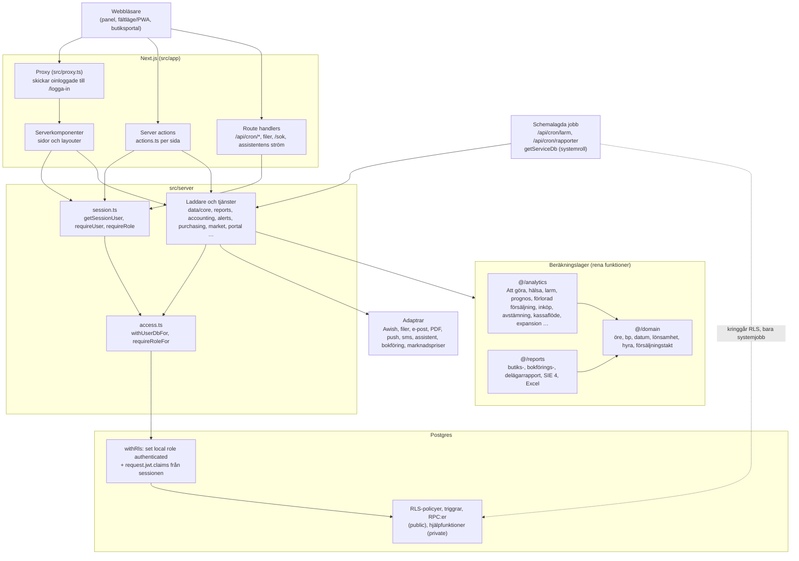
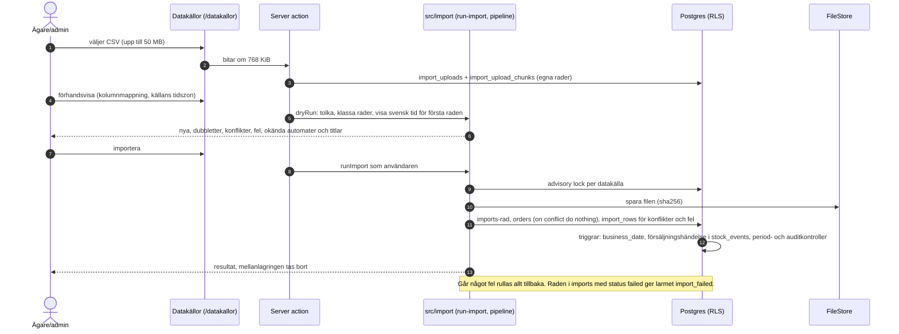
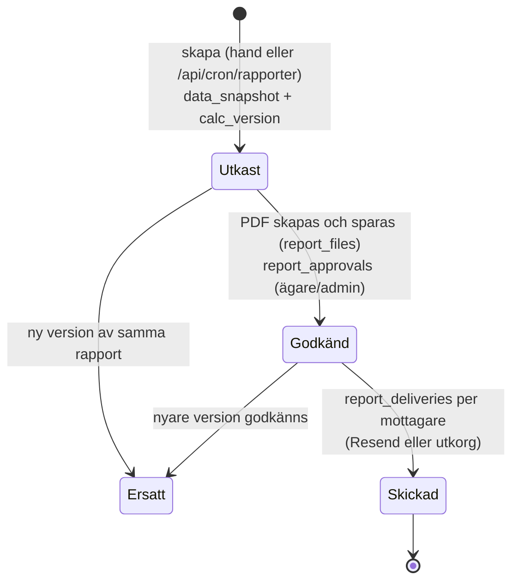
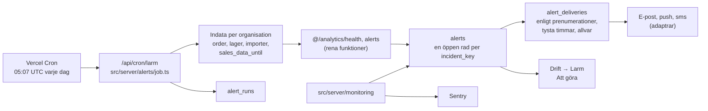

# Arkitektur

Hur Binderlab är byggt: lagren, adaptrarna mot omvärlden, beräkningslagret, de schemalagda jobben, de viktigaste
dataflödena och säkerhetsmodellen. Tabellerna står i `docs/datamodell.md`, reglerna för siffrorna i
`docs/berakningar.md`, miljöerna i `docs/miljoer.md` och driften i `docs/operations.md`. Varför det blev så står i
`docs/decisions.md`.

## Översikt

| Del           | Val                                                                                                           |
| ------------- | ------------------------------------------------------------------------------------------------------------- |
| Webb          | Next.js 16 (App Router, React 19, serverkomponenter och server actions), TypeScript i strikt läge             |
| Utseende      | Tailwind CSS v4 med egna tokens (`src/styles/tokens.css`), egna komponenter och diagram (`src/components`)    |
| Databas       | Postgres 16 (Supabase i drift, lokal Postgres med en auth-shim i utveckling), RLS på varje tabell             |
| Databasklient | Drizzle ORM över postgres.js (`src/db`); migreringar som SQL-filer i `supabase/migrations`                    |
| Inloggning    | Supabase Auth (JWT mot JWKS) i drift, en egen dev-inloggning lokalt (`src/server/auth`)                       |
| Drift         | Vercel (webb och cron), Supabase (databas, Auth, Storage), Sentry (fel och cron-övervakning), Resend (e-post) |
| Tester        | vitest: enhetstester, databastester mot riktig Postgres, e2e med Playwright mot en körande server             |

## Lager



**Regeln i ett stycke.** Allt som görs på uppdrag av en användare går via `withUserDb()` (`src/server/session.ts`),
som kör i en transaktion som rollen `authenticated` med claims (`sub`, `email`) från den verifierade sessionen
(`withRls` i `src/db/client.ts`). Varje server action som ändrar något anropar dessutom `requireRole()`, som läser
rollen ur `memberships` under RLS. Databasen är det som faktiskt skyddar data; kontrollen i koden ger tidiga och
tydliga fel. `getServiceDb()` kringgår RLS och används bara av systemjobb och skript (cron, seed, migrering,
gallring) och i två dokumenterade fall före inloggning (`docs/miljoer.md`).

**Sidor.** Varje sida i `src/app/(app)/<sida>/` har samma form: `page.tsx` (serverkomponent som laddar och visar),
`_lib/` (modell, validering och laddare för just sidan, med tester), `_components/` och `actions.ts` (server
actions). Gemensamma laddare för order, lager, priser och sammanhang ligger i `src/server/data/core`
(`loadContext`, `loadDomainInput`, `loadStock`, `loadTodoState` …). De är cachade per förfrågan med Reacts `cache`.

**Beräkningslagret.** `src/domain` är grunden (pengar, datum, priser, hyra, provision, lönsamhet, enhetsekonomi,
fördelning). `src/analytics` och `src/reports` bygger på den. Ingen av dem läser databasen, klockan eller miljön:
indata är vanliga objekt, och sidan, rapporten, assistenten och testerna anropar samma funktioner. `purity.test.ts`
kontrollerar att `src/domain` inte använder `Date`, `Intl`, slump eller miljön, och att resultaten är identiska i UTC,
Europe/Stockholm och Asia/Shanghai (`npm run test:domain:tz`).

## Mappar

```
src/
  app/                 Next: (app)/ panelens sidor, portal/ butiksportalen, rapport/ rapportsidan (PDF och mejl),
                       api/cron/ schemalagda jobb, logga-in/, inbjudan/, design/ och datamodell/ (internt)
  server/              Allt som körs på servern: session och behörighet, laddare, tjänster och adaptrar per område
  domain/              Rena beräkningar (öre, bp, datum, lönsamhet, hyra, enhetsekonomi)
  analytics/           Rena analyser ovanpå domain (todos, health, alerts, forecast, lost-sales, purchasing,
                       reconciliation, cashflow, contracts, expansion, effect, pricing, assortment, releases, visits …)
  reports/             Rena rapportmodeller, SIE 4 (CP437) och Excel
  import/              Importens adaptergränssnitt, Awish (gRPC-API och CSV) och den gemensamma pipelinen
  db/                  Drizzle-schema (typer), anslutning (withRls, getServiceDb), migreringskörare
  components/          ui/ (knappar, tabell med egen virtualisering, KPI, modal …), charts/ (egna SVG-diagram),
                       shell/ (sidomeny, toppbar, period), report/ (rapportens utskriftsläge), pwa/
  emails/              Mejlmallen för rapporter
  seed/                Seed med verksamhetens riktiga försäljning (exempelbutiker) och demo/ (påhittad demo)
  lib/                 env (validering), format (sv-SE), period, säkerhetshuvuden, tema
  styles/              tokens.css
supabase/migrations/   SQL-migreringar med tabeller, RLS, triggrar och RPC:er (en fil per ändring, tidsstämplad)
supabase/local/        auth-shim.sql (schemat auth för lokal Postgres; körs aldrig mot Supabase)
scripts/db/            reset, migrate, seed, seed-demo, backup, restore
test/db/               Databastester (RLS, isolering, triggrar, tjänster, attacktester)
e2e/                   Webbläsartester (Playwright-biblioteket och vitest)
```

## Adaptrar

All kontakt med omvärlden går via ett gränssnitt med en lokal implementation, så att allt kan köras och testas utan
nätverk och nycklar. Implementationen väljs med en miljövariabel (`src/lib/env.ts` validerar dem vid start).

| Område           | Gränssnitt (fil)                                              | Implementationer                                                                                                                                                                                                                                                                                                                                                         | Variabel                                |
| ---------------- | ------------------------------------------------------------- | ------------------------------------------------------------------------------------------------------------------------------------------------------------------------------------------------------------------------------------------------------------------------------------------------------------------------------------------------------------------------ | --------------------------------------- |
| Orderkälla       | `SourceAdapter` (`src/import/adapter.ts`)                     | `awish_csv` (uppladdning, i bruk), `awish_grpc` (Awish officiella gRPC-API, var femte minut via pg_cron → `/api/cron/awish`, `src/server/awish`, `docs/awish-api.md`), `awish_web` (serverhämtning av orderlistan som reserv om gRPC dröjer: finns i enumen och i gränssnittet men har ingen adapter, och en fil till en sådan källa nekas i `src/import/run-import.ts`) | per datakälla (`data_sources.provider`) |
| Filer för import | `FileStore` (`src/import/file-store.ts`)                      | lokal katalog `.data/imports`, Supabase Storage (bucket `imports`)                                                                                                                                                                                                                                                                                                       | `IMPORT_FILE_STORE`                     |
| Inloggning       | `AuthProvider` (`src/server/auth/types.ts`)                   | `dev` (egen, bara lokalt), `supabase` (JWT mot JWKS)                                                                                                                                                                                                                                                                                                                     | `AUTH_PROVIDER`                         |
| E-post           | `Mailer` (`src/server/mail/report-mailer.ts`)                 | `outbox` (filer i `.data/outbox`), `resend`                                                                                                                                                                                                                                                                                                                              | `MAIL_PROVIDER`                         |
| PDF              | `PdfRenderer` (`src/server/pdf/render.ts`)                    | `local` (puppeteer-core + Chromium), `sparticuz` (Vercel), `off`                                                                                                                                                                                                                                                                                                         | `PDF_RENDERER`                          |
| Rapportlagring   | `src/server/reports/storage.ts`                               | `local` (`.data/reports`), `supabase` (bucket `reports`)                                                                                                                                                                                                                                                                                                                 | `REPORT_STORAGE`                        |
| Avtalsfiler      | FileStore (`src/server/accounting/contract-files.ts`)         | `local`, `supabase` (bucket `contracts`)                                                                                                                                                                                                                                                                                                                                 | `CONTRACT_FILE_STORE`                   |
| Push             | `PushSender` (`src/server/notify/push.ts`)                    | `webpush` (VAPID), `outbox`                                                                                                                                                                                                                                                                                                                                              | `PUSH_PROVIDER`                         |
| Sms              | `SmsSender` (`src/server/notify/sms.ts`)                      | `outbox`, `off` (ingen leverantör vald)                                                                                                                                                                                                                                                                                                                                  | `SMS_PROVIDER`                          |
| Assistent        | `ModelClient` (`src/server/assistant/model-client.ts`)        | `anthropic` (Claude API), `local` (testmodell utan AI, bara lokalt)                                                                                                                                                                                                                                                                                                      | `ASSISTANT_PROVIDER`                    |
| Bokföring        | `BookkeepingAdapter` (`src/server/accounting/bookkeeping.ts`) | `none`, `local` (utkorg); Fortnox, Visma eEkonomi, Bokio förberedda men inte byggda                                                                                                                                                                                                                                                                                      | `ACCOUNTING_PROVIDER`                   |
| Utbetalningar    | `PayoutSource` (`src/server/accounting/payout-source.ts`)     | `csv` (uppladdning; en PDF läses som Nayax månadsrapport), `awish_api` (kastar tills Awish lämnat dokumentation)                                                                                                                                                                                                                                                         | `PAYOUT_SOURCE`                         |
| Marknadspriser   | `MarketPriceSource` (`src/server/market/sources/types.ts`)    | `none`, `local` (testfil); externa källor ger läget "inte inkopplad"                                                                                                                                                                                                                                                                                                     | `MARKET_PRICE_SOURCE`                   |
| Fel och cron     | `src/server/monitoring`                                       | Sentry när `SENTRY_DSN` finns, annars bara larm i appen                                                                                                                                                                                                                                                                                                                  | `SENTRY_DSN`                            |

Saknas en nyckel stoppar det inte appen: sidan som behöver den säger vad som saknas (till exempel "Assistenten kräver
ANTHROPIC_API_KEY", "Ej konfigurerad" för bokföringen, `ConfigMissing` för inloggade sidor utan databas).

## Schemalagda jobb

| Route                 | Schema (UTC, `vercel.json`) | Gör                                                                                                     | Kör som                     |
| --------------------- | --------------------------- | ------------------------------------------------------------------------------------------------------- | --------------------------- |
| `/api/cron/larm`      | `7 5 * * *`                 | Maskinhälsa, titel nära slut, misslyckade importer, gårdagens försäljning; sparar larm; skickar utskick | systemroll (`getServiceDb`) |
| `/api/cron/rapporter` | `17 5 1 * *`                | Utkast för förra månadens butiks-, bokförings- och delägarrapporter (skickar ingenting)                 | systemroll                  |

Båda kräver `Authorization: Bearer <CRON_SECRET>` (minst 16 tecken; utan den svarar de 503, fel hemlighet ger 401),
checkar in hos Sentry Cron Monitors och skriver systemlarm (`job_failed`, `report_failed`) när något går fel för en
organisation. Proxyn släpper igenom `/api/cron/*` utan session; skyddet är hemligheten. Larmjobbet får köra i 60 s
och rapportjobbet i 300 s (`maxDuration`).

## Dataflöden

### Import av orderlistan



- En order ändras aldrig. Samma ordernummer med avvikande innehåll blir `conflict` i loggen, och ordern lämnas orörd.
- Okänd titel blir ny titel med alias; okänd automat hamnar i kön (`source_machines` utan automat) och ordern sparas
  utan automat tills någon kopplar den.
- `business_date` räknas av databasen ur `ordered_at` i organisationens tidszon. Källans tidszon
  (`data_sources.source_timezone`, Awish troligen Asia/Shanghai) används bara för att tolka klockslagen i filen.

### Rapport



- Underlaget fryses i `reports.data_snapshot` med beräkningsversionen (`CALC_VERSION`). PDF, Excel och SIE 4 räknas
  ur ögonblicksbilden, så det som skickas är exakt det som godkändes.
- PDF:en skrivs av headless Chromium som öppnar `/rapport/[id]` med den inloggades cookies; mejlet renderas på samma
  sätt från `/rapport/[id]/epost`.
- Databasen stoppar utskick av en rapport som inte är godkänd och omdirigering av `storage_path` till en annan
  rapports fil. Butiksportalen visar bara den senaste godkända versionen.

### Larm



- Maskinhälsan härleds ur försäljningen (Poisson mot samma veckodag och timme de senaste 8 veckorna) och räknar
  tystnaden bara fram till hur långt importerad försäljning räcker (`sales_data_until`), så en fil som inte laddats
  upp än larmar inte alla automater.
- Samma problem är ett larm: nya fel räknar upp förekomster i stället för att skapa nya rader. Användare får bara
  kvittera.

## Säkerhetsmodell

### Roller

| Roll       | Ser                                                                                                                                                                                   | Gör                                                                                               |
| ---------- | ------------------------------------------------------------------------------------------------------------------------------------------------------------------------------------- | ------------------------------------------------------------------------------------------------- |
| `owner`    | allt i organisationen                                                                                                                                                                 | allt, inklusive roller, ägarandelar och öppning av stängd månad                                   |
| `admin`    | allt                                                                                                                                                                                  | allt utom ägarroll, ägarandelar och öppning av stängd månad                                       |
| `viewer`   | allt utom inbjudningar och medlemshantering (delägaren)                                                                                                                               | inget                                                                                             |
| `refiller` | bara tillåtlistan: butiker (namn, adress), automater, placeringar, titlar, lager, larm om automater och lager, lagerpunkter i Att göra, egna prenumerationer och egna assistentfrågor | påfyllning, inventering, svinn och flytt (`performed_by` = sig själv), avbockning av lagerpunkter |
| `store`    | ingenting i appens tabeller; bara sin egen butik via `portal_*`-funktionerna                                                                                                          | felanmälan från butiksportalen                                                                    |

### Lager av skydd

1. **Proxyn** skickar oinloggade till `/logga-in`. Den är bara en bekvämlighet.
2. **Serverkoden** verifierar sessionen (Supabase-JWT mot JWKS med issuer, audience och exp; dev-sessionen mot
   `DEV_AUTH_SECRET`) och kontrollerar rollen med `requireRole()` i varje server action och route.
3. **RLS** på alla tabeller, `to authenticated`, via `private.orgs_with_role(...)`. Grants för `anon` är återkallade.
   Påfyllarens åtkomst är en tillåtlista: varje annan tabell har policyn "ägare, admin, läsare", så en ny tabell blir
   aldrig synlig för påfyllaren av misstag. Ingen policy nämner rollen `store`.
4. **Sammansatta FK:er** `(organization_id, x_id)` gör att en rad aldrig kan peka på en annan organisations rad, och
   `private.forbid_org_change()` hindrar att `organization_id` ändras.
5. **Triggrar och RPC:er** i `private` och `public` (security definer, `search_path = ''`) skyddar regler som RLS inte
   kan uttrycka: sista ägaren, rollhöjning, stängda månader, append-only, sökvägar till filer, utskick bara för
   godkända rapporter. Kontroller som läser organisationens data körs efter RLS (AFTER-triggrar eller en
   `t05_rls_gate` före), så felkoderna inte avslöjar något om andra organisationer.
6. **Kolumnrättigheter**: klienter får bara uppdatera vissa kolumner (till exempel `orders.title_id` och `machine_id`).
7. **Storage**: privata buckets (`imports`, `reports`, `contracts`) med sökvägen `{organization_id}/…` och policyer
   mot `has_role`. Klienter kan ladda upp och läsa, men inte skriva över eller radera.

### Ändringslogg, append-only och perioder

- `audit_log` skrivs bara av triggern `private.audit()`; ingen roll kan skriva, ändra eller radera i den. Den loggar
  priser, lager, avtal, placeringar, inställningar, ägarandelar, konton, medlemskap, inbjudningar, titlar och alias,
  stamdata (butiker, automater, datakällor, mottagare), rapportgodkännanden och utskick, perioder, ekonomi
  (fasta kostnader, utredningar, leveranser), marknad, expansion och avbockningar.
- **Append-only** (fel rättas med nya rader): `stock_events`, `audit_log`, `import_rows`, `report_deliveries`,
  `report_approvals`, `report_files`, `payout_imports`, `payout_lines`, `deviation_reviews`, `voucher_deliveries`,
  `assistant_logs`.
- **Ingen hård radering** av ekonomiska data (bokföringslagen): de arkiveras, och gallring kräver databasägaren med
  `binderlab.allow_purge = 'on'`.
- **Månadsstängning** (`period_closes`): en stängd månad skyddar priser, lager, avtal, placeringar, fasta kostnader och
  återbetalningar som påverkar den (BL004). Bara ägaren kan öppna, och det loggas. Sent importerade order sparas och
  flaggas (`orders.late_in_closed_period`).

### Övrigt

- **Säkerhetshuvuden** (`src/lib/security-headers.ts`): CSP, `X-Frame-Options: DENY`, HSTS, `nosniff`,
  `Referrer-Policy`, `Permissions-Policy`. Smalare CSP för PDF-visning.
- **Gränser per serverinstans** (`createRateLimiter` i `src/server/rate-limit.ts`, minne i processen, så varje
  Vercel-instans räknar för sig):

  | Vad                        | Gräns                                                                                | Kod                                                                              |
  | -------------------------- | ------------------------------------------------------------------------------------ | -------------------------------------------------------------------------------- |
  | Inloggning med lösenord    | 5 försök per IP och e-post, och 20 misslyckade per konto, på 15 minuter              | `src/server/actions/auth.ts`, `ACCOUNT_LOGIN_LIMIT` i `src/server/auth/flows.ts` |
  | Inloggningslänk (Supabase) | 5 per IP och per e-post på 15 minuter                                                | `src/app/logga-in/actions.ts`                                                    |
  | Assistenten                | 60 frågor per användare och timme                                                    | `src/app/(app)/assistent/fraga/route.ts`                                         |
  | Sökning (`GET /sok`)       | 240 per användare och minut                                                          | `src/app/(app)/sok/route.ts`                                                     |
  | Provlarm                   | 3 per användare och 20 per organisation på 10 minuter                                | `src/app/(app)/drift/actions.ts`                                                 |
  | Felanmälan från portalen   | 10 per användare och timme, och dessutom högst 20 per användare och dygn i databasen | `src/server/portal/actions.ts`, `portal_report_fault`                            |

  Inbjudningar och rapportutskick har ingen gräns.

- **Okänt id ger HTTP 404.** Next.js bestämmer statuskoden när svaret börjar strömmas, och ett
  `loading.tsx` ovanför sidan gör att `notFound()` i sidan bara ger 200 med `noindex`. Detaljsidorna
  (`automater/[automat]`, `butiker/[butik]`, `inkorg/[id]`, `drift/automat/[id]`,
  `datakallor/importer/[id]`) kontrollerar därför id:t i en egen `layout.tsx` (snabb fråga eller skalets redan
  laddade stamdata) och har sitt laddningsläge i segmentet under den. Listsidans `page.tsx` och `loading.tsx`
  ligger i gruppen `(oversikt)`, så att listans laddningsläge inte omsluter detaljsidan, och sidan för okänt
  id (`not-found.tsx`) ligger ett segment upp, där layoutens `notFound()` fångas. Provat i
  `e2e/01-inloggning.e2e.test.ts` och `src/components/ui/detail-status.test.ts`.
- **Nekad sida förklaras.** `requireRoute` skickar den som saknar behörighet till rollens startsida med
  `?nekad=<rutt>` (`deniedHref` i `src/components/shell/nav.ts`), och skalet visar en notis om vem sidan är för
  (`DeniedNotice`) och tar bort parametern ur adressen.
- **Temat** renderas på servern ur cookien `binderlab-theme` (`src/lib/theme.ts`): rätt `data-theme` i första
  HTML-svaret, inget inline-skript.
- **Push-endpoints** måste vara en känd push-tjänst (både i servern och i databasen) så att servern inte kan fås att
  anropa interna adresser.
- **Sentry** får bara id:n och antal; e-post, cookies, Authorization-rubriker och inbjudningstoken tvättas bort (`src/server/observability/sentry-options.ts`, används av `src/server/monitoring/sentry.ts`).
- **Attacktester**: `test/db/redteam-*.test.ts` och `src/server/redteam-fas7*.test.ts` prövar server actions, rutter,
  RPC:er, storage, IDOR och export mot varje roll.

## Tider och pengar

| Regel             | Hur                                                                                                                                                                           |
| ----------------- | ----------------------------------------------------------------------------------------------------------------------------------------------------------------------------- |
| Belopp            | Hela öre som `bigint` (`*_ore`) i databasen och heltal i TypeScript. Flyttal används aldrig för pengar.                                                                       |
| Procent           | Baspunkter som `integer` (`*_bp`): 10 % = 1 000 bp.                                                                                                                           |
| Avrundning        | På ett ställe (`roundHalfUp` i `src/domain/money.ts`): halva öre bort från noll, per order eller per butik och månad, aldrig på summor. Fördelningar med största-restmetoden. |
| Tidpunkter        | `timestamptz` i UTC. Anslutningen sätter `TimeZone: UTC` (`src/db/client.ts`).                                                                                                |
| Affärsdatum       | `date` i organisationens tidszon (`organizations.timezone`, standard Europe/Stockholm), räknat av databasen (`orders.business_date`, `stock_events.business_date`).           |
| Källans tidszon   | Per datakälla (`data_sources.source_timezone`). Används bara för att tolka klockslagen i källfilen; förhandsvisningen visar tolkad svensk tid.                                |
| Intervall         | Inklusiva: `valid_to` är sista giltiga dagen, null betyder tills vidare.                                                                                                      |
| Tidszonsoberoende | Beräkningar, import och seed körs i CI under UTC, Europe/Stockholm och Asia/Shanghai och ska ge identiska resultat.                                                           |
| Visning           | `src/lib/format.ts` (sv-SE, tabulära siffror).                                                                                                                                |
