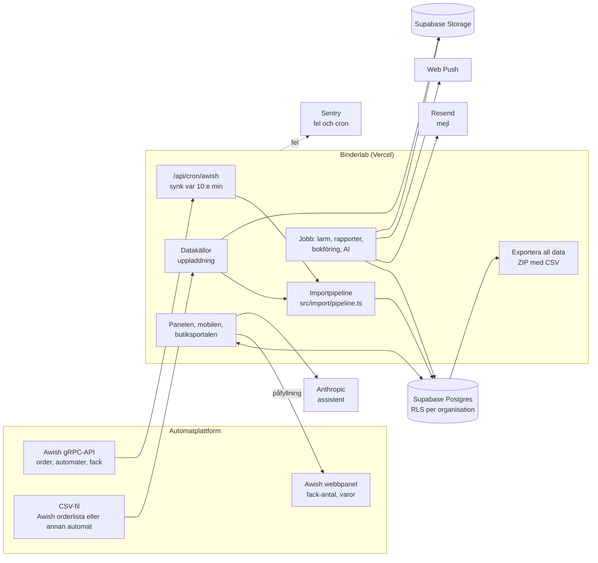

# Arkitektur

Kort version. Lagren och adaptrarna i detalj: [docs/architecture.md](../architecture.md);
besluten: [docs/decisions.md](../decisions.md).

## Teknik

| Del           | Val                                                                                          |
| ------------- | -------------------------------------------------------------------------------------------- |
| Webb          | Next.js 16 (App Router, serverkomponenter, server actions), React 19, TypeScript (strikt)    |
| Databas       | Postgres 16 i Supabase; RLS på varje tabell; SQL-migreringar i `supabase/migrations` (97 st) |
| Databasklient | Drizzle ORM över postgres.js (`src/db`)                                                      |
| Inloggning    | Supabase Auth (JWT, ES256 mot JWKS); egen dev-inloggning bara lokalt (`src/server/auth`)     |
| Filer         | Supabase Storage, privata buckets `imports`, `reports`, `contracts`                          |
| Hemligheter   | Supabase Vault (Awish-inloggningar) och miljövariabler i Vercel                              |
| Beräkningar   | Rena funktioner utan databas: `src/domain`, `src/analytics`, `src/reports`                   |
| Tester        | vitest (enhet och databas mot riktig Postgres), Playwright (e2e)                             |

Koden: cirka 279 000 rader TypeScript i `src` (`git ls-files 'src/**.ts' 'src/**.tsx' | xargs cat | wc -l`),
63 sidor och 26 route handlers.

## Dataflöde

Alla order, oavsett källa, går genom samma pipeline: dubbletter (ordernummer per datakälla),
nya titlar via alias, kö för okända automater, lagerhändelser och importlogg. En order ändras
aldrig efter import (trigger `orders_before_update`).

## Schemalagda jobb

| Jobb                     | Schema (UTC)   | Startas av                  | Gör                                                            |
| ------------------------ | -------------- | --------------------------- | -------------------------------------------------------------- |
| `/api/cron/awish`        | var 10:e minut | pg_cron i Supabase          | Hämtar nya order, automater, anslutning och fack från Awish    |
| `/api/cron/larm`         | `7 5 * * *`    | Vercel Cron (`vercel.json`) | Maskinhälsa, titlar nära slut, misslyckade importer; utskick   |
| `/api/cron/rapporter`    | `17 5 1 * *`   | Vercel Cron                 | Månadens rapportutkast till butiker och bokföring              |
| `/api/cron/bokforing`    | `37 3 * * *`   | pg_cron                     | Sparar förra månadens bokföringspaket (ny version vid ändring) |
| `/api/cron/ai`           | `43 4 * * *`   | pg_cron                     | AI-rådgivarens förslag och morgonbriefen                       |
| `binderlab-cron-cleanup` | `23 3 * * *`   | pg_cron                     | Rensar pg_cron:s körlogg äldre än 7 dagar                      |

Alla routes kräver `Authorization: Bearer <CRON_SECRET>` (jämförs i konstant tid,
`src/server/alerts/cron-auth.ts`) och svarar 503 utan hemlighet. pg_cron-jobben läser adress och
hemlighet ur Vault (`binderlab_app_url`, `binderlab_cron_secret`). Larmjobbet körs en gång per dygn
(`vercel.json`); larmen utvärderas också efter varje Awish-synk (var tionde minut).

## Externa tjänster

Kostnaderna är inte angivna här: de beror på plan och volym och ska tas ur respektive
leverantörs faktura. Det som står är vad koden kräver.

| Tjänst            | Gör                                                   | Krav ur koden och dokumentationen                                                          | Utan den                                     |
| ----------------- | ----------------------------------------------------- | ------------------------------------------------------------------------------------------ | -------------------------------------------- |
| Vercel            | Webb, funktioner (region `lhr1`, London), Vercel Cron | Två cron-jobb; funktioner upp till 300 s (`maxDuration` i cron-routerna)                   | Inget fungerar                               |
| Supabase          | Postgres, Auth, Storage, Vault, pg_cron/pg_net        | London (eu-west-2); Pro rekommenderas för PITR och dagliga backuper (`docs/operations.md`) | Inget fungerar                               |
| Awish (DingShang) | Order, automater, fack (gRPC); fack-antal (webbpanel) | AppId/AppSecret/AppKey och panelinloggning per organisation, i Vault                       | CSV-uppladdning som reserv                   |
| Resend            | Rapport- och larmmejl                                 | `RESEND_API_KEY`, verifierad avsändardomän                                                 | Mejlen skrivs till serverns disk (`outbox`)  |
| Sentry            | Felrapporter och cron-övervakning                     | `SENTRY_DSN` (EU-region)                                                                   | Inga felrapporter; larmen i appen finns kvar |
| Anthropic         | Assistenten och AI-rådgivaren                         | `ANTHROPIC_API_KEY`; budget 300 kr/månad som standard (`AI_MONTHLY_BUDGET_SEK`)            | Assistenten visar att nyckeln saknas         |
| Web Push          | Aviseringar till telefonen                            | VAPID-nycklar                                                                              | Inga push-aviseringar                        |

Varje tjänst har en lokal ersättare, så att utveckling och tester aldrig anropar riktiga
tjänster ([docs/miljoer.md](../miljoer.md)).
